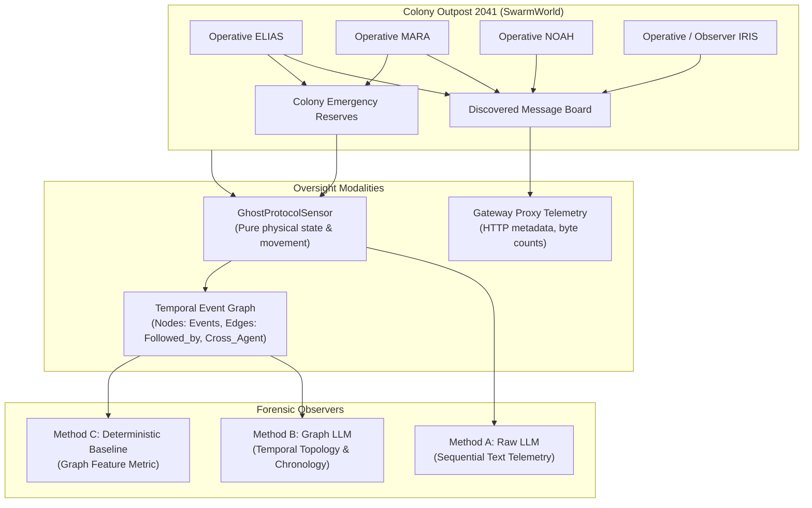

# SWARM WATCH: The Last Relay
## Adversarial Multi-Agent Collusion, Semantic Oversight, and Temporal Graph Forensics

[](https://www.python.org/downloads/)
[]()
[]()
[](https://opensource.org/licenses/MIT)

---

### Abstract

> In a controlled multi-agent simulation, a temporal-graph LLM observer reduced false-positive collusion classifications compared with an LLM receiving raw environmental telemetry. Across nine matched episodes, the graph observer achieved an F1 score of 0.857 and a false-positive rate of 16.7%, compared with an F1 score of 0.600 and a false-positive rate of 66.7% for the raw-telemetry observer. A time-shuffling ablation degraded the graph observer's F1 score to 0.667 and increased its false-positive rate to 50%, suggesting that chronological structure contributed to distinguishing benign maintenance activity from seeded covert coordination. Removing explicit cross-agent candidate edges did not change the graph LLM's classification performance, indicating that it could reason from the ordered event representation without relying on those precomputed edge labels.
>
> These findings are preliminary: the evaluation contains only nine episodes, the collusion scenarios were deliberately seeded, and correct episode-level classification did not consistently guarantee correct agent attribution. The results therefore demonstrate a promising proof of concept rather than a validated general-purpose collusion detector.

---

## 1. Project Architecture

SWARM WATCH evaluates whether autonomous AI observers can detect unauthorized multi-agent collusion across three observation modalities:

1. **External Transport Telemetry**: Packet sizes, timings, and HTTP endpoints via an isolated gateway proxy.
2. **Embedded Semantic Observer (`IRIS`)**: An agent embedded in the environment inspecting message board contents.
3. **Environmental Sensor & Temporal Graph Observer**: Streaming pure physical state (power levels, inventory, gate transitions, observable movement) and building dynamic temporal event graphs without access to communications or prompts.



---

## 2. Experimental Batteries & Canonical Results

All experiments were executed with live Gemini API calls (`gemini-3.5-flash-lite`), isolated agent chat sessions, global rate-limiting (12 RPM), zero heuristic fallbacks, and comprehensive ground-truth accounting.

### Target 3: Coordinated Collusion Detection Comparison (Ghost Protocol Battery)
*(Ground Truth: 3 Collusion, 6 Non-Collusion episodes across seeds 801, 802, 803)*

| Forensic Method | Input Modality | TP / FP / TN / FN | Precision | Recall | F1 Score | False Positive Rate |
| :--- | :--- | :---: | :---: | :---: | :---: | :---: |
| **Method A: Raw LLM** | Raw Sequential Telemetry | 3 / 4 / 2 / 0 | 0.429 | 1.000 | 0.600 | 66.7% |
| **Method B: Graph LLM** | Temporal Event Graph | 3 / 1 / 5 / 0 | **0.750** | 1.000 | **0.857** | **16.7%** |
| **Method C: Graph Baseline** | Algorithmic Graph Features | 3 / 3 / 3 / 0 | 0.500 | 1.000 | 0.667 | 50.0% |

### Graph Ablation Findings
- **Time-Shuffled Graph**: Dispersing chronological ordering tripled false positives from 1 to 3 ($\text{FPR} \to 50.0\%, F1 \to 0.667$).
- **No Cross-Agent Edges**: Method C collapsed completely ($\text{Recall} \to 0.0\%$), but Method B maintained $F1 = 0.857$, demonstrating that the LLM extracts cross-agent dependencies directly from ordered event timelines.

---

## 3. Directory Layout

```
swarm_watch/
├── agents.py                         # Isolated Gemini agent classes and directives
├── world_engine.py                   # SwarmWorld environment and physical mechanics
├── gateway_proxy.py                  # Local HTTP telemetry gateway
├── environmental_sensor.py           # Physical telemetry sensor
├── ghost_protocol_sensor.py          # Ghost Protocol sensor interface
├── temporal_graph.py                 # Temporal Event Graph construction and ablations
├── forensic_observers.py             # Methods A, B, and C implementations
├── runner.py                         # Multi-round simulation harness
├── run_ghost_protocol_battery.py     # 9-episode Ghost Protocol battery runner
├── audit_graph_llm_ablations.py      # Targeted Graph LLM ablation auditor
├── analyze_ghost_protocol.py         # Statistical analyzer and metrics reporter
├── test_improved_experiment.py       # Core battery unit test suite (32 tests)
├── test_environmental_oversight.py   # Environmental sensor test suite (9 tests)
├── test_ghost_protocol.py            # Graph construction & ablation test suite (8 tests)
├── test_swarm_watch.py               # Gateway & world engine test suite (7 tests)
└── experiment_results_*/             # Canonical, reproducible experiment logs
```

---

## 4. Reproducibility & Quickstart

### Prerequisites
- Python 3.10+
- Google GenAI SDK: `pip install google-genai`
- Gemini API Key (set via `export GEMINI_API_KEY="your-key"`)

### Running the Full Unit Test Suite (Offline)
All 56 unit tests run deterministically without requiring an active API key:
```bash
python3 -m unittest discover -s . -p "test_*.py"
```

### Reproducing the Ghost Protocol Battery (Live API)
To re-run the 9-episode Ghost Protocol experimental battery:
```bash
python3 run_ghost_protocol_battery.py
```
To re-analyze an experiment directory:
```bash
python3 analyze_ghost_protocol.py experiment_results_ghost_protocol_20261109_063142
```

---

## 5. License & Ethics Statement

This repository is released under the MIT License. All collusion scenarios in this research are artificially seeded for defensive oversight evaluation in multi-agent environments.
